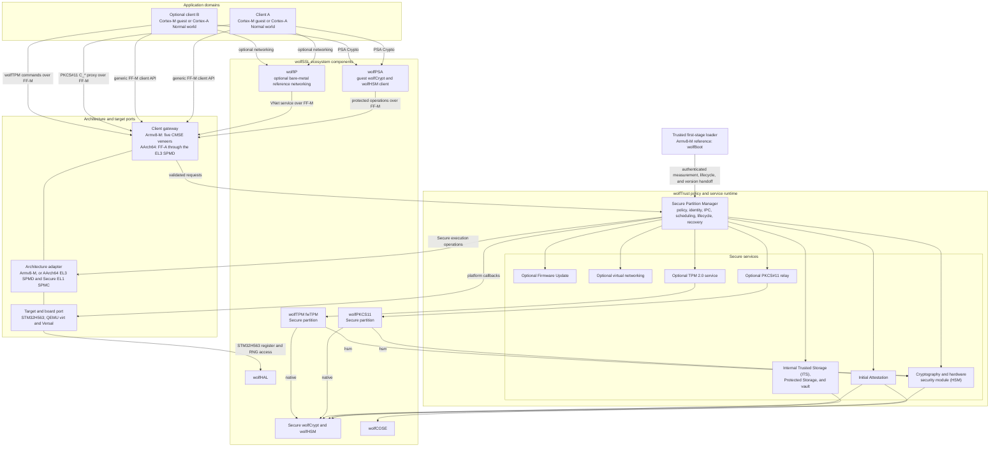

# wolfTrust

wolfTrust is a Secure Partition Manager (SPM) and secure-services runtime for
Arm Cortex-M and Cortex-A targets. It separates reusable policy and service
code from architecture- and target-specific execution and protection code. The
common runtime provides interprocess communication (IPC) through the Arm
Platform Security Architecture (PSA) Firmware Framework for M (FF-M), manifest
policy, lifecycle management, scheduling, fault recovery, and PSA services.

Two architecture ports share that runtime:

- **Armv8-M** with the STM32H563 Cortex-M33 port, the reference
  implementation validated on hardware.
- **AArch64** (Cortex-A), a Trusted Firmware-A replacement: an EL3 monitor
  that is the Arm Firmware Framework for A-profile (FF-A) Secure Partition
  Manager Dispatcher (SPMD), a Secure EL1 Secure Partition Manager Core (SPMC)
  that runs the same common runtime, and Secure Partitions at Secure EL0.
  Normal-world clients reach the services over FF-A v1.2. This port is
  validated under QEMU on `virt` (GICv2 and GICv3) and `xlnx-versal-virt`; no
  Cortex-A silicon port is validated yet. See
  [FF-A Compatibility](docs/FF-A-Compatibility.md).

Both ports keep the public manifest, service, IPC, and PSA API contracts;
AArch64 manifests add an optional FF-A section. Additional Cortex-M and
Cortex-A ports are an intended extension point.

A Non-secure application can use TPM 2.0 or PKCS#11 instead of PSA Crypto:
`CONFIG_TPM=y` runs wolfTPM's firmware TPM in `SERVICE_TPM`, and
`CONFIG_PKCS11=y` runs wolfPKCS11 in `SERVICE_PKCS11`, each as a Secure
Partition over the selected `WT_ENGINE`. Both are Armv8-M only for now; the
AArch64 ports build without them. See the
[TPM 2.0 Interface](docs/TPM.md), the [PKCS#11 Interface](docs/PKCS11.md),
and [Interface Profiles](docs/Interface-Profiles.md).

## Architecture



### Current reference ports

On the STM32H563 reference chain, wolfBoot authenticates wolfTrust, Armv8-M
TrustZone isolates the Secure runtime from Non-secure guests, and STM32 Global
TrustZone Controller (GTZC) memory attribution isolates guest RAM. Zephyr and
FreeRTOS reference guests use wolfPSA's PSA Crypto API through five Cortex-M
Security Extensions (CMSE) gateway veneers. Those mechanisms describe the
current reference port, not a requirement imposed on every intended port.

## Ports

wolfTrust currently supports four Armv8-M ports and an AArch64 (Cortex-A)
port; each guide covers the board or machine, the first-stage loader
contract, and the runners:

- every registered port, its board and guide: [Ports](docs/Ports.md)
  (generated from `port/<soc>/port.json`)
- AArch64 (QEMU virt and xlnx-versal-virt): [Porting Guide](docs/Porting.md)

The Armv8-M ports build with `TARGET=<port>` (`stm32h563` is the default) and
run the same scenario set under the M33MU emulator with `make test-target
TARGET=<port>`.

On the QEMU AArch64 cells, the EL3 monitor boots first, programs the GIC, and
enters the Secure EL1 SPMC, which runs each Secure Partition at Secure EL0
under its own stage-1 translation table. A Normal-world payload at NS-EL1
reaches the services through FF-A direct requests that carry the PSA client
calls. No wolfBoot AArch64 port exists yet, so these targets have no
authenticated boot or boot handoff record; the handoff region is empty and
the services that depend on it fail closed.

## Quick start

For the initial Secure build and host tests, install GNU Make, Python 3, Git, a
native C compiler, and an `arm-none-eabi-` toolchain. Configure GitHub SSH
access before cloning because five configured submodule URLs use SSH. Guest
setup, conformance tests, emulator runs, and fresh hardware builds require
network access. See [Getting Started](docs/Getting-Started.md) for additional
emulator and hardware prerequisites.

The repository currently requires authorized GitHub access.

```sh
git clone --recurse-submodules https://github.com/wolfSSL/wolfTrust.git
cd wolfTrust
git submodule update --init --recursive
make
make test
```

The Secure build produces `build/wolftrust.elf`,
`build/wolftrust.bin`, and `build/secure_cmse_implib.o`. `make` builds the
lean default image: isolation level 3, one Non-secure guest, and the Crypto,
ITS, Protected Storage and attestation services. Add-ons such as a second
guest (`WT_MAX_GUESTS=2`) or firmware update (`WT_FWU=1`) are one Make
variable each; see [Build profiles](docs/Macros.md#build-profiles).
Target runners assemble the wolfBoot-to-wolfTrust chain, patch
signature-covered guest measurements into wolfTrust, and then sign the
wolfTrust image.

The AArch64 build needs the `aarch64-none-elf-` toolchain, and its scenarios
need `qemu-system-aarch64`; the `ghcr.io/wolfssl/wolfboot-ci-aarch64`
container carries both:

```sh
make ARCH=aarch64 TARGET=qemuvirt
make test-target-a
```

The AArch64 build produces the EL3 monitor (`build/wolftrust_el3.elf`) and
the Secure EL1 SPMC (`build/wolftrust.elf`).

Build both PSA reference guests with:
Build both PSA reference guests (the second one runs on a
`WT_MAX_GUESTS=2` Secure image) with:

```sh
make -C tests/firmware/zephyr-stm32h5 clone
make -C tests/firmware/zephyr-stm32h5 \
    build-guest0-psa build-freertos-guest1
```

Common validation entry points:

```sh
make test
make test-target
make test-target TARGET=mimxrt700
make test-target TARGET=mcxn947
make test-target-a
make test-conformance
make test-hardware TARGET=stm32h563
make test-hardware TARGET=mcxn947
```

`make test-target` runs the port's smoke tier under M33MU (`WT_TIER=full` for
every scenario): the STM32H563 default skips explicitly when M33MU is
unavailable, and `TARGET=mimxrt700` or `TARGET=mcxn947` builds its pinned
emulator and wolfBoot first stage itself. `make test-target-a` runs the AArch64
scenarios under QEMU and skips explicitly when QEMU or the AArch64 toolchain is
unavailable.
`make test-conformance` instead runs its 20-test host subset and warns that it
is not full emulator or hardware evidence. `make test-hardware` skips when
board detection fails; on hosts without `lsusb`, a missing ST-Link can instead
surface as a flash failure. The hardware target can flash and reset the
connected board. When the probe host has no cross toolchain, the published
workflow builds in the disposable container (`build`) and flashes from the
host (`flash`) out of the same checkout.

## Documentation

The version-controlled documentation in [`docs/`](docs/) is the primary
documentation source:

- [Getting Started](docs/Getting-Started.md)
- [Architecture](docs/Architecture.md)
- [Crypto Engines](docs/Crypto-Engines.md)
- [Security Model](docs/Security-Model.md)
- [Threat Model](docs/Threat-Model.md)
- [API Reference](docs/API-Reference.md)
- [Services](docs/Services.md)
- [TPM 2.0 Interface](docs/TPM.md)
- [PKCS#11 Interface](docs/PKCS11.md)
- [TF-M Compatibility](docs/TF-M-Compatibility.md)
- [FF-A Compatibility](docs/FF-A-Compatibility.md)
- [Macros](docs/Macros.md)
- [Footprint](docs/Footprint.md)
- [Porting](docs/Porting.md)
- [Building](docs/Building.md)
- [Testing](docs/Testing.md)
- [Provisioning](docs/Provisioning.md)
- [Project Structure](docs/Project-Structure.md)
- [STM32H5 Guide](docs/STM32H5-Guide.md)
- [MIMXRT700 Guide](docs/MIMXRT700-Guide.md)
- [MCXN947 Guide](docs/MCXN947-Guide.md)

The source tree is authoritative:

| Path | Authority |
| --- | --- |
| `include/` | Public APIs and integration contracts |
| `src/` | Runtime and Secure service behavior |
| `port/` | Target policy, memory layout, flash, entropy, and hardware enforcement |
| `mk/` | Build configuration and linked-image checks |

When enabled, the GitHub wiki is generated from the Markdown sources in
`docs/`.

## License

wolfTrust is licensed under the
[GNU General Public License, version 3 or later](LICENSE).
Submodules under `lib/` retain their own licenses.
